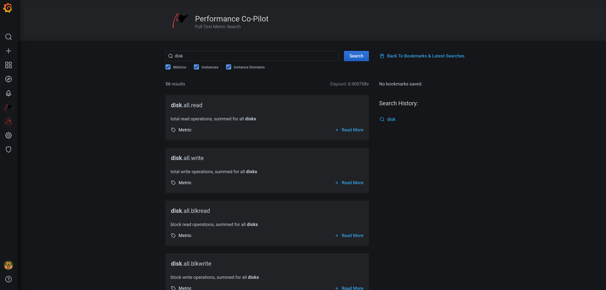

Performance Co-Pilot adds a **Metric Search** page to the Grafana main menu, at `/a/performancecopilot-pcp-app`. Open it to search, inspect and bookmark the PCP metrics, instances and instance domains exposed through your configured data sources.

## Search for metrics, instances and instance domains

1. Enter a name or pattern in the search box at the top of the page. Suggestions appear as you type.
2. Use the **Metrics**, **Instances** and **Instance Domains** checkboxes to limit which entity types the search returns. All three are selected by default.
3. Click **Search**.

Matching results appear with how long the search took and how many results matched. Click a result to open its detail page. From there, click **Back To Results for:** to return to the search results, or **Back To Bookmarks & Latest Searches** to return to the landing page.

## Reuse recent searches and bookmarks

The landing page shows two lists:

- **Search History:** Your past search queries. Click one to run it again, or click **Clear History** to remove them all.
- **Bookmarked Results:** Metrics and instance domains you bookmarked. Click one to reopen its detail page, or click **Clear Bookmarks** to remove them all.

Click **Back To Bookmarks & Latest Searches** (shown whenever you're not already on the landing page) to return to these lists.

## View metric details

A metric's detail page shows one card per series the metric has, for example one per monitored host. Each series has two tabs:

- **Metadata:** The metric's `PMID`, `Type`, `Semantics`, `Units`, `Indom` and `Source`. When the metric has an instance domain, click its `Indom` value to open that instance domain's detail page.
- **Labels:** The series' labels, when it has any.

From a metric's detail page, you can also:

- Click **Bookmark** to add the metric to your bookmarks, or **Unbookmark** to remove it.
- Click **Preview** to open the metric in the [PCP Valkey: Metric Preview dashboard](./dashboards.md#pcp-valkey-metric-preview-dashboards), pre-filled with the metric name. This requires the PCP Valkey data source.

## View instance domain details

An instance domain's detail page lists its instances. Click **Bookmark** or **Unbookmark** to add or remove it from your bookmarks.